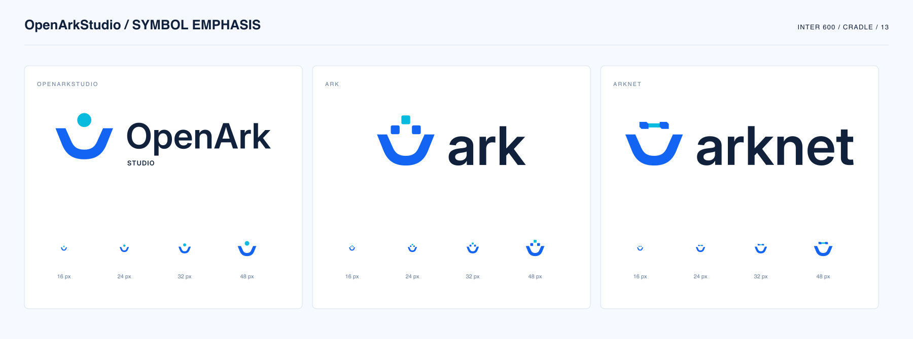

# OpenArkStudio 视觉资源

[English](README.md)

正式标识采用承托舟体、Inter 600 字标与电蓝、亮青配色。组织图标带一个圆点，ark 带三个模块，arknet 带连接节点。

已选定「图形稍强」比例：舟体高度 88、小写 x-height 80、可见图文间隔 40 单位。组织图标上提 17.6 单位，与 OpenArk / STUDIO 双行字标做光学对齐。

## 文件

将 `{brand}` 替换为 `openarkstudio`、`ark` 或 `arknet`。

| 文件 | 用途 |
| --- | --- |
| `{brand}-logo-light.svg` | 浅色背景组合标 |
| `{brand}-logo-dark.svg` | 深色背景组合标 |
| `{brand}-logo-mono.svg` | 单色组合标 |
| `{brand}-icon.svg` | 独立图标 |
| `{brand}-icon-dark.svg`、`{brand}-icon-mono.svg` | 深色与单色图标 |
| `{brand}-wordmark-light.svg`、`-dark.svg`、`-mono.svg` | 不带图标的纯字标 |
| `{brand}-avatar.png` | 512 × 512 透明 PNG |
| `{brand}-social-preview.svg`、`.png` | 1280 × 640 GitHub 分享卡片 |
| `identity.json` | 选定比例、配色与字体元数据 |

27 个标识 SVG 均为透明背景，含可访问标题，文字已转为路径。另有三张浅色背景的分享卡片，说明文字也已转为路径。所有 SVG 均不依赖已安装字体或外部字体请求。

## 配色与布局

- 浅色背景：电蓝 `#1464F4`、亮青 `#06BBDD`、文字 `#11213B`。
- 深色背景：蓝色 `#508AFF`、青色 `#2CD6EE`、文字 `#F2F7FF`；预览底色为 `#101D34`。
- 保持 SVG 原始宽高比。README 中设置宽度，让高度自动适配。
- 项目 README 引用本目录中的正式资源，文档站本地副本需与归档文件一致。

Inter 使用 [SIL Open Font License](Inter-OFL.txt)，字体来源为 [Google Fonts Inter 目录](https://github.com/google/fonts/tree/main/ofl/inter)。
